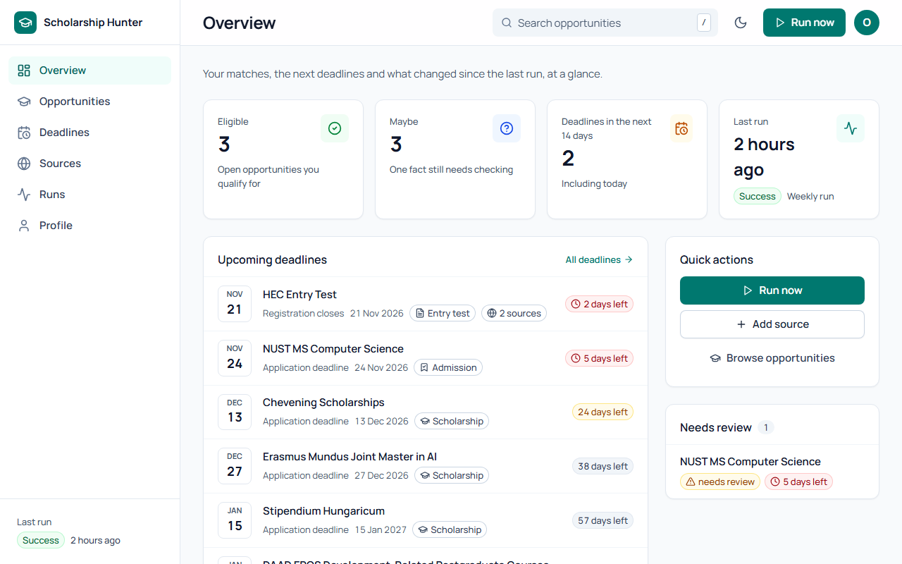
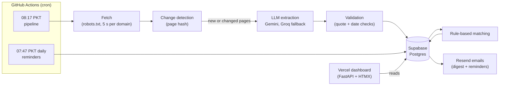

# Scholarship Hunter

[](https://github.com/Aiman-Hafeez-0/Scolarship-hunter-agent/actions/workflows/ci.yml)

Missing a scholarship deadline because it was buried on some university page is a common way to
lose one. Scholarship Hunter is a personal AI agent that watches official scholarship, admission
and entry-test pages for you. It politely fetches each page, uses an LLM to pull out deadlines
and requirements, and keeps a fact only when the exact quote it came from is really on the page.
Simple rules then check each opportunity against your profile, and you get a weekly email digest
plus reminders before each deadline. A small dashboard shows every fact next to its quote.

**Live dashboard:** <https://scolarship-hunter-agent.vercel.app> (login required: it holds one
person's data).

### What it does

- **Polite fetching of official sources**: obeys robots.txt, waits 5 seconds between requests
  to the same site, identifies itself with a contact address, and never logs in.
- **LLM extraction with quote-verified facts**: Gemini (Groq as fallback) reads each page; every
  deadline, fee and requirement must come with an exact quote, which the code checks against
  the page.
- **Rule-based matching**: plain Python rules compare each opportunity with your profile
  (eligible, maybe, not eligible) and rank them with a 0-100 score.
- **Email digest and reminders**: a weekly digest (action needed, new matches, changes, items
  that need review) and reminders 30, 14, 7 and 2 days before each deadline.
- **Dashboard**: matches, upcoming deadlines, each fact with its source quote, sources and run
  history; you can also edit your profile and start a run.



More screenshots: [docs/screenshots/](docs/screenshots/). A 2-minute demo walkthrough is in
[docs/demo-script.md](docs/demo-script.md).

## Architecture



1. The **08:17 pipeline** fetches every source, skips pages whose text has not changed since the
   last run, sends only new or changed pages to the LLM, checks every fact, saves the result in
   Supabase, matches it against the profile and (on Mondays) emails the digest.
2. The **07:47 reminders** job reads the saved deadlines and emails a reminder when one is
   30, 14, 7 or 2 days away, plus admin alerts (a failed run or source, token budget almost
   used up).
3. The **dashboard** on Vercel reads the same database.

## Engineering decisions

- **Every fact must quote the page.** LLMs sometimes invent dates. So the LLM must return an
  exact quote for each fact, and the code checks that quote against the page text (fuzzy match,
  score 90/100 or more). A deadline's day and month must also be written inside its quote. A
  fact that fails is dropped and the item is flagged for review: no quote, no fact.
- **Matching uses rules, not the LLM.** Eligibility (nationality, degree, field, CGPA, English
  test, age, work experience, fee, deadline) is checked by small, tested Python functions. They are predictable, explain every
  result in one line, cost nothing to run, and the owner's personal profile is never sent to an
  LLM provider. The LLM only ever sees public web pages.
- **Polite scraping.** robots.txt is checked (RFC 9309) before every fetch, at most one request
  per site every 5 seconds, a clear User-Agent with a contact email, a 30 s timeout, 2 retries
  with backoff on 429/5xx, and never anything behind a login.
- **Built to live on free tiers.** Unchanged pages (same hash) are never sent to the LLM again.
  When Gemini's daily quota runs out, the run switches to Groq for the rest of the day; for
  Groq, each request is sized to fit its tokens-per-minute limit before it is sent. Tokens are
  counted, and an admin email goes out at 80% of the monthly budget. Hosting is Vercel Hobby,
  Supabase free and GitHub Actions.
- **The workflows apply database migrations.** Each scheduled run first applies any new SQL
  file in `db/migrations/`, each one in its own transaction, recorded in a
  `schema_migrations` table. Running it again is harmless, so the database is never behind the
  code.
- **Measured with a golden set, not by feel.** 15 real pages have answers written by hand.
  `python -m pipeline.eval` runs the real extraction on them and logs accuracy to
  [results.csv](pipeline/tests/golden/results.csv). Latest run (2026-11-18, Groq
  `openai/gpt-oss-120b`, prompt `extract_v2`): **deadlines 22% (8 of 36)**, funding type 64%,
  open to Pakistan 55%, application fee 75%. The scoring is strict (an invented date counts
  against the page), and these numbers are exactly why every fact is quote-checked and items
  with doubts are marked "needs review" instead of trusted.
- **Tested and type-checked.** ruff, mypy and pytest (with a real Postgres service) run in CI
  on every push.

## Setup

1. **Install uv** (the Python package manager):
   - Windows (PowerShell): `powershell -ExecutionPolicy ByPass -c "irm https://astral.sh/uv/install.ps1 | iex"`
   - macOS/Linux: `curl -LsSf https://astral.sh/uv/install.sh | sh`
2. **Install dependencies** (uv also downloads Python 3.12 if needed):
   ```
   uv sync
   ```
   This installs everything: the dashboard's libraries, the pipeline's (the `pipeline` group)
   and the test tools (the `dev` group).
3. **Create your `.env`**: copy `.env.example` to `.env` and fill in the values. Each line has a
   comment saying where to get it. Never commit `.env`.
4. **Check everything works**:
   ```
   uv run ruff check .
   uv run mypy pipeline app
   uv run pytest
   ```

## Project layout

| Path | What it is |
| --- | --- |
| `pipeline/` | Agent code |
| `pipeline/nodes/` | Individual steps of the agent |
| `pipeline/tests/` | Tests |
| `pipeline/config.py` | Settings, read from `.env` |
| `app/` | The dashboard (FastAPI web app) and its tests |
| `db/migrations/` | Database migrations |
| `.github/workflows/` | CI and the scheduled runs |
| `data/` | Local downloaded files (not committed) |

## Dashboard

A small website that shows what the agent found: your matches, the next deadlines, every fact
with the quote it came from, the sources and the run history. You can also mark items as
checked, switch sources on or off, edit your profile and start a run.

It is plain FastAPI + Jinja2 + HTMX (no JavaScript framework), styled with Tailwind. How it
looks (colors, type, components, layout rules) is written down in
[docs/design.md](docs/design.md); the page pieces are in `app/templates/components/`.
There is a dark mode toggle in the top bar, and `/` jumps to the search box.

### Run it on your computer

1. Make your login. It asks for a password twice and prints two lines:
   ```
   uv run python -m app.hash_password
   ```
2. Put those two lines in `.env`, plus `DASHBOARD_EMAIL=` with your email. `DATABASE_URL` must
   already be there. For the "Run now" button, also fill in `RUN_NOW_GITHUB_TOKEN` and
   `RUN_NOW_GITHUB_REPO` (and `RUN_NOW_GITHUB_REF` if the branch is not `main`). They start with
   `RUN_NOW_` so they never clash with the `GITHUB_*` variables GitHub Actions sets itself.
3. Start it:
   ```
   uv run uvicorn app.main:app --reload
   ```
4. Open <http://localhost:8000> and log in.

### Rebuild the CSS after changing the look

The pages use `app/static/app.css`, built by Tailwind from the classes in the templates. The
built file is committed, so you only rebuild it when you change classes in a template, in
`app/static/app.js`, or in `app/assets/tailwind.css`:

```
uv run python -m app.build_css
```

This uses Tailwind's standalone program (no Node.js). The first time, it downloads it (about
100 MB) into `.tools/` (ignored by git) and checks its checksum. While you work on the look,
`uv run python -m app.build_css --watch` rebuilds the file on every save. Commit the new
`app/static/app.css` together with your template changes.

### Put it online with Render (free)

1. Push the repository to GitHub (with `Dockerfile` and `render.yaml`).
2. Sign in at <https://render.com> with your GitHub account.
3. Click **New > Blueprint**, pick this repository, and click **Connect**. Render reads
   `render.yaml` and plans one web service, `scholarship-hunter-dashboard`.
4. Render asks for a value for each environment variable. Paste them from your `.env`:
   - `DATABASE_URL`: the Supabase **Session pooler** URI (the direct one does not work on Render).
   - `DASHBOARD_EMAIL`, `DASHBOARD_PASSWORD_HASH`, `SESSION_SECRET`: your login (step 1 above).
     The hash may be pasted with or without its quotes.
   - `CONTACT_EMAIL`: your email (sent to websites when you add a source).
   - `RUN_NOW_GITHUB_TOKEN`, `RUN_NOW_GITHUB_REPO`: for "Run now" (leave empty if you do not
     want it).
5. Click **Apply**. The first build takes a few minutes. When it says **Live**, open the
   `https://...onrender.com` address shown at the top of the service page.
6. Later changes: every push to GitHub deploys again. Change a value under the service's
   **Environment** tab (it restarts by itself).

> **The free service sleeps.** After 15 minutes with no visits Render stops it, and the next
> visit starts it again, so the **first page takes about a minute** to load. After that it is fast.

Good to know:
- Use a long, unique password. On Render, failed logins from everyone are counted together
  (5 per 15 minutes), so someone guessing can lock you out for up to 15 minutes.
- Pages are slower if Render and Supabase are far apart. `render.yaml` picks Singapore, the
  same region as the database (`ap-southeast-1`).

### Deploy on Vercel (free Hobby plan)

Vercel runs the dashboard as a Python "serverless function": no Docker, and it starts on
the first visit (about a second) instead of running all the time. The files it uses:

- `vercel.json`: run in Singapore (`sin1`, next to Supabase's `ap-southeast-1`), include the
  page templates and `app/static/` (the CSS, `app.js` and htmx), leave out tests and local
  files.
- `pyproject.toml`: `[tool.vercel]` names the app (`app.main:app`). Vercel installs only the
  main `dependencies` (about 30 MB). The pipeline's heavy libraries are in the `pipeline`
  group, which only the GitHub workflows (and `uv sync` on your computer) install.
- `.vercelignore`: files never uploaded (`.env`, `profile.yaml`, tests, `data/`, `.venv/`).

Steps:

1. **Create the login-limit table first.** Push your code to GitHub, then open the **Actions**
   tab, pick **Daily reminders** and click **Run workflow**. Its "Apply database migrations"
   step creates the `login_failures` table the login page needs. (Every daily and weekly run
   does this too; you only start one by hand so the table exists before your first login.)
2. Sign in at <https://vercel.com> with your GitHub account and choose the **Hobby** plan.
3. Click **Add New... > Project**, find this repository and click **Import**.
4. Vercel should show **Framework Preset: FastAPI**. Leave Root Directory as `./` and the
   build and install commands empty (the defaults).
5. Open **Environment Variables** and add each one below (copy the values from your `.env`;
   paste them without quotes):

   | Variable | Value |
   | --- | --- |
   | `DATABASE_URL` | Supabase > **Connect** > **Session pooler** URI (port 5432). Not the direct one (Vercel cannot reach it) and not the Transaction pooler. |
   | `DASHBOARD_EMAIL` | The email you log in with |
   | `DASHBOARD_PASSWORD_HASH` | From `uv run python -m app.hash_password` (the part after `=`) |
   | `SESSION_SECRET` | From the same command (at least 32 characters) |
   | `CONTACT_EMAIL` | Your email (sent to websites when you add a source) |
   | `RUN_NOW_GITHUB_TOKEN` | Optional, for "Run now": fine-grained token, this repository only, "Actions: Read and write" |
   | `RUN_NOW_GITHUB_REPO` | Optional, for "Run now": `owner/name` |
   | `RUN_NOW_GITHUB_REF` | Optional: the branch, if it is not `main` |

   Vercel sets `VERCEL=1` by itself. The dashboard then reads the visitor's real IP address
   from Vercel's `X-Forwarded-For` header, so the login limit counts each address on its own.
6. Click **Deploy**. When it finishes, open `https://<your-project>.vercel.app/health`; it
   should show `{"status":"ok"}`. Then open the main address and log in.
7. Check the region: **Project > Settings > Functions > Function Region** should say
   Singapore (`sin1`). (Hobby allows one region of your choice; `vercel.json` picks it.)
8. Later changes: every push to `main` deploys again. After changing an environment
   variable, open **Deployments**, click **...** on the newest one and choose **Redeploy**.

Good to know:
- Failed logins (5 per 15 minutes per IP address) are saved in the `login_failures` table,
  because Vercel may run each request on a different instance and instances share no memory.
  If the login page says "Database problem", step 1 has not run yet.
- Deploys of other branches ("previews") are protected by Vercel's own login by default;
  your `main` address is the public one.
- The Render files (`Dockerfile`, `render.yaml`) still work; you can use either host.

### End-to-end test (optional)

A browser test logs in, opens the list, opens a detail page and presses the verify button. It
needs a real browser, so it is skipped unless `E2E=1` (CI skips it):
```
uv sync --group e2e
uv run --group e2e playwright install chromium
E2E=1 uv run --group e2e pytest app/tests/test_e2e.py
```
(In PowerShell: `$env:E2E = "1"` first, then the `pytest` line without `E2E=1`.)
It needs internet access only for the Manrope font (htmx and the CSS are served by the app).

## Running in production

Two GitHub Actions workflows run on their own. Both can also be started by hand from the
**Actions** tab ("Run workflow").

| Workflow | When (Pakistan time) | What it does |
| --- | --- | --- |
| `daily.yml` | Every day, 07:47 PKT | Deadline reminders (30, 14, 7 and 2 days before) and admin alerts |
| `weekly.yml` | **Trial week:** every day, 08:17 PKT. **From 28 Nov 2026:** Mondays, 08:17 PKT | Fetch, extract and save every source, match profiles, then send the digest (Mondays only, or when you tick `send_digest` in a manual run) |

After 27 Nov 2026, change the cron line in `weekly.yml` from `"17 3 * * *"` to
`"17 3 * * 1"`. GitHub cron times are in UTC (PKT = UTC+5), and a scheduled run can start a
few minutes late.

**JavaScript pages.** Sources with `render_js: true` (COMSATS admissions, the DAAD database)
are empty without JavaScript, so `weekly.yml` opens them in a headless Chromium (Playwright,
the `browser` dependency group; Chromium is cached between runs). The same rules apply:
robots.txt for the page and for every data request it makes, the 5-second wait per site, and
no images, fonts or style sheets are downloaded. On your computer these sources are skipped
("needs a browser") unless you add the group and Chromium yourself: run
`uv run --group browser playwright install chromium` once, then start the pipeline with
`uv run --group browser python -m pipeline.run weekly` (a plain `uv run` removes the group).

A third workflow, `test-email.yml` (manual only), sends one test email to `ADMIN_EMAIL` so you
can check the mail secrets. It uses `MAIL_PROVIDER`, `RESEND_API_KEY` and `ADMIN_EMAIL` (or the
Gmail ones).

### Secrets

Add these under **Settings > Secrets and variables > Actions > New repository secret**. Each one
is described in `.env.example`.

| Secret | Needed for |
| --- | --- |
| `DATABASE_URL` | Both workflows |
| `CONTACT_EMAIL` | Both (shown in the bot's User-Agent) |
| `GEMINI_API_KEY` | Weekly (main LLM) |
| `GROQ_API_KEY` | Weekly (fallback LLM) |
| `MAIL_PROVIDER` | Both: `resend` (the default if empty) or `gmail` |
| `RESEND_API_KEY` | Both, when `MAIL_PROVIDER` is `resend` |
| `GMAIL_ADDRESS` | Both, when `MAIL_PROVIDER` is `gmail` |
| `GMAIL_APP_PASSWORD` | Both, when `MAIL_PROVIDER` is `gmail` |
| `ADMIN_EMAIL` | Both (admin alerts; without it, alerts are skipped) |
| `MONTHLY_TOKEN_BUDGET` | Optional, daily: LLM token budget per month (empty = 1,000,000) |

> **Warning:** in a **public** repository, GitHub turns off scheduled workflows after 60 days
> with no commits. GitHub emails you before it happens. To turn a workflow back on, open it in
> the Actions tab and click **Enable workflow**, or push any commit.

## License

[MIT](LICENSE)
