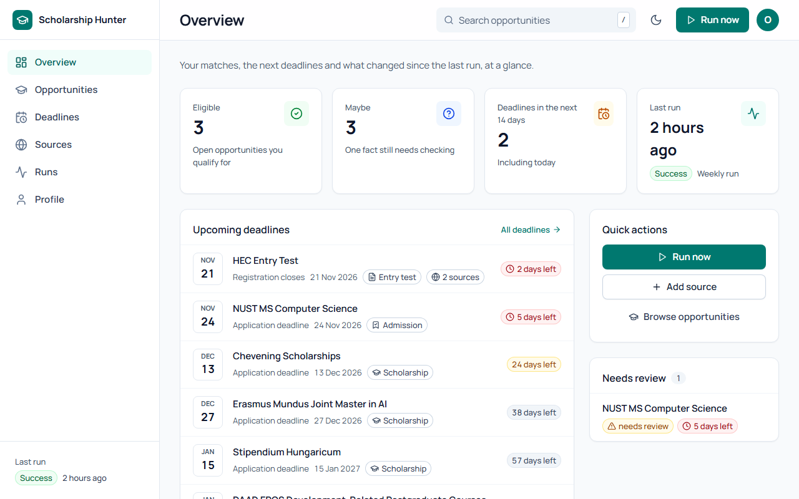
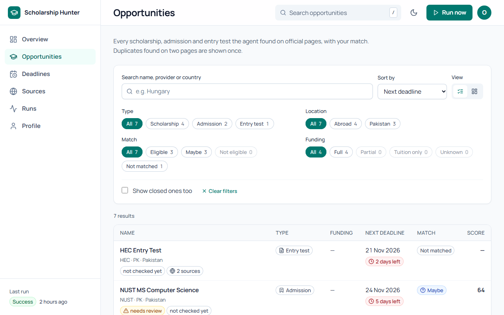

# Screenshots

Add these 4 PNG files to this folder, using exactly these names (the main README links to them).
Take them from the live dashboard at a browser width of about 1280 px. Before saving, hide or
blur anything personal (your email address, date of birth, CGPA).

| File | What to show |
| --- | --- |
| `home.png` | The dashboard home page: the "Action needed" matches and the next deadlines. The main README shows this one at the top. |
| `list.png` | The scholarship list page with a few rows visible: name, status, match result, next deadline. |
| `detail.png` | One scholarship's detail page, with each fact (deadline, fee, requirements) next to the exact quote from the official page. This is the most important one: it shows that no fact is made up. |
| `digest-email.png` | A weekly digest email open in Gmail (or another inbox), showing the "Action needed" and "New matches" sections. |

## Gallery

### Home

### List

### Detail with quotes

### Digest email

