# Screenshots

Every dashboard page, taken with made-up demo data (no real profile or email), at desktop
(1280 × 800) and phone (390 × 844) size. The main README shows `home.png`.

**Still to add by hand:** `digest-email.png`, a weekly digest email open in Gmail (or another
inbox), showing the "Action needed" and "New matches" sections. Hide your email address.

| Page | Desktop | Phone |
| --- | --- | --- |
| Overview | `home.png` (and `home-dark.png`) | `home-mobile.png` |
| Opportunities | `list.png` | `list-mobile.png` |
| Detail with quotes | `detail.png` | `detail-mobile.png` |
| Deadlines by week | `deadlines.png` | `deadlines-mobile.png` |
| Deadlines calendar | `calendar.png` | `calendar-mobile.png` |
| Sources | `sources.png`, `add-source.png` (live checks) | `sources-mobile.png` |
| Runs (one row opened) | `runs.png` | `runs-mobile.png` |
| Profile (unsaved changes) | `profile.png` | `profile-mobile.png` |
| Login | `login.png` | `login-mobile.png` |
| Page not found | `not-found.png` | `not-found-mobile.png` |

## Gallery

### Overview

### Overview in dark mode
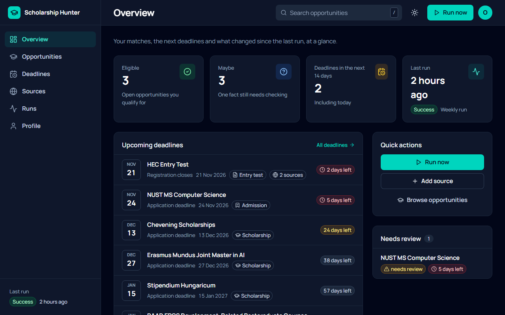

### Opportunities

### Detail with quotes
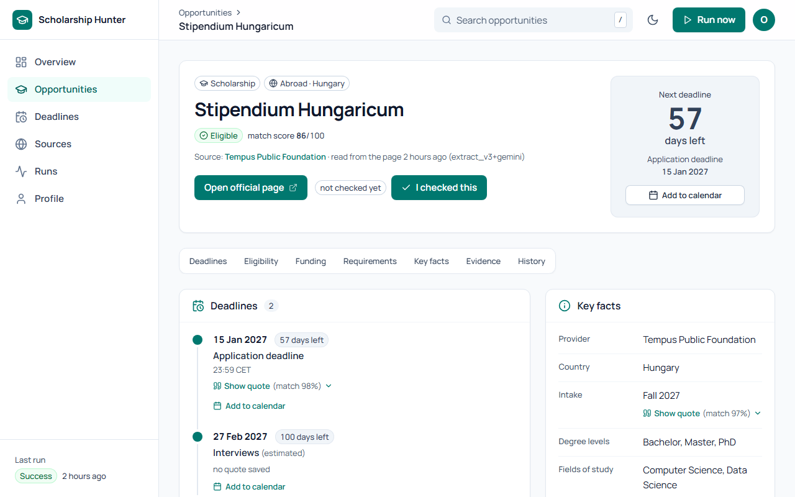

### Deadlines
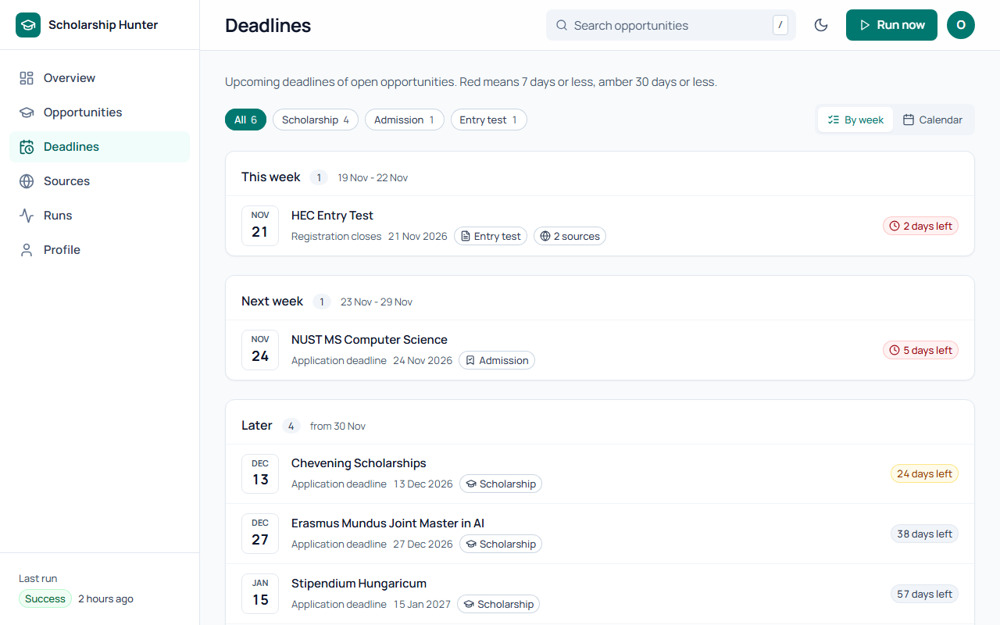
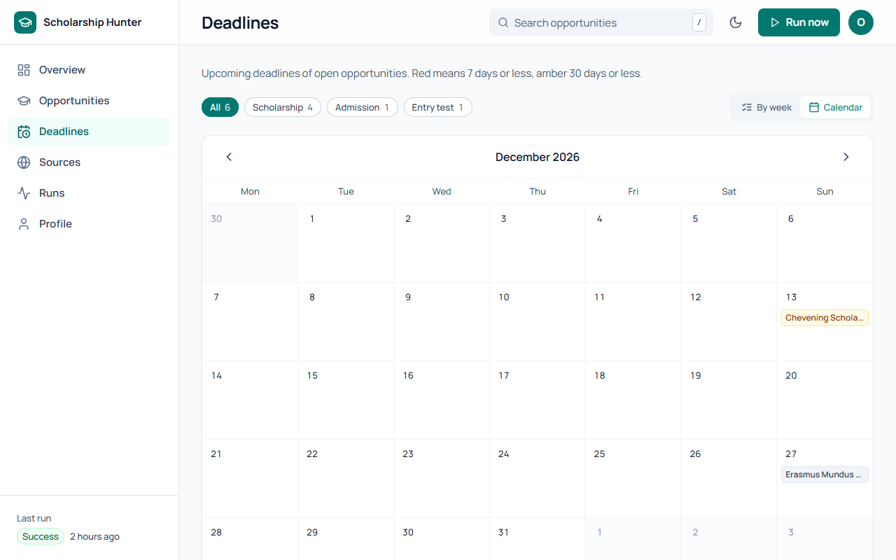

### Sources
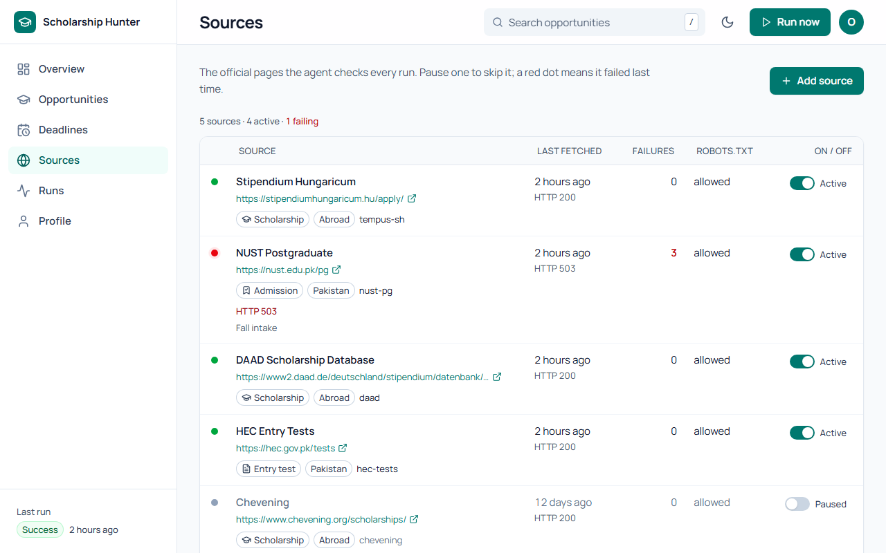
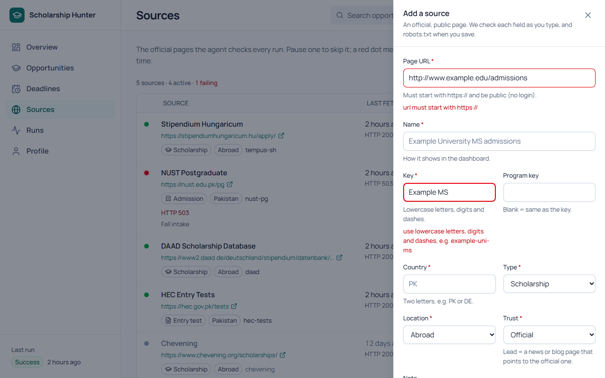

### Runs
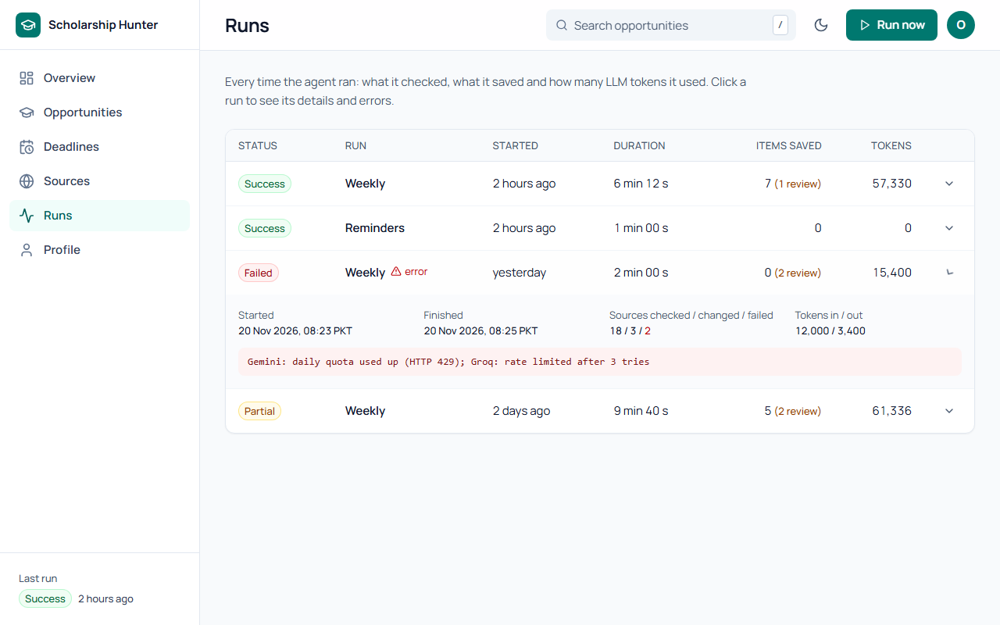

### Profile
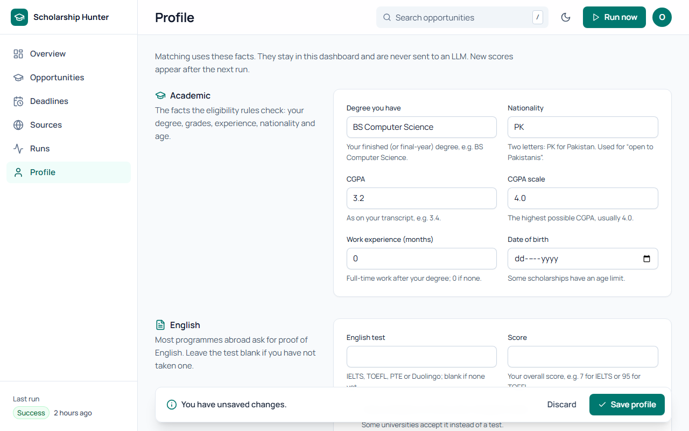

### Login
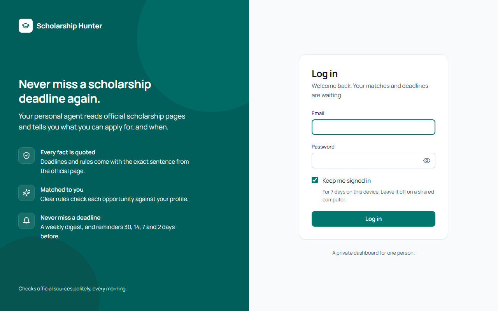

### Phone

  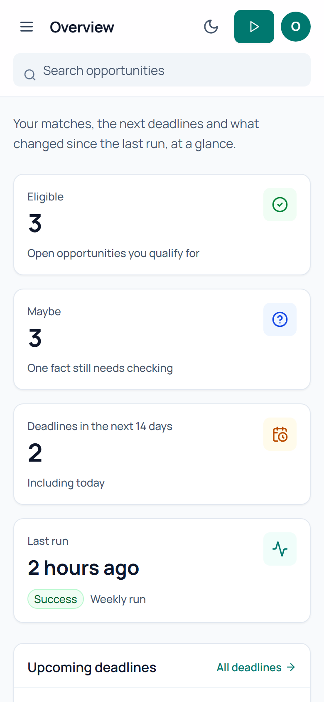
  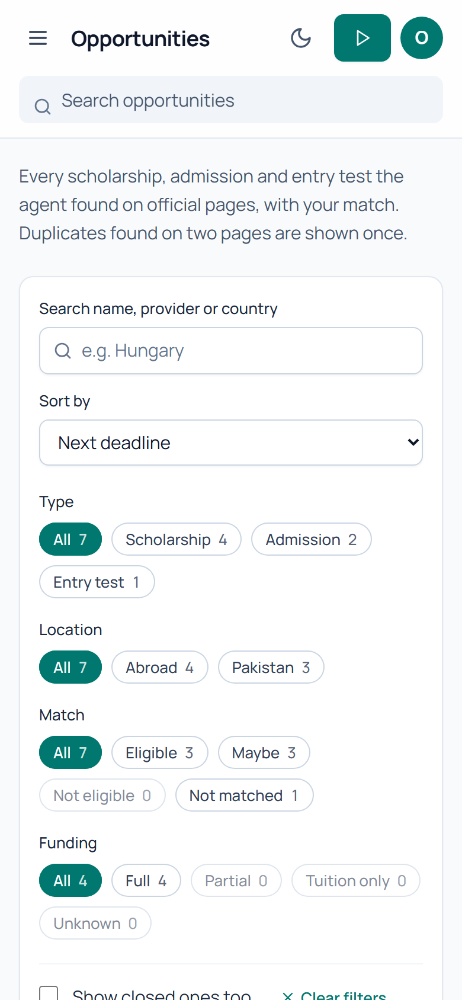
  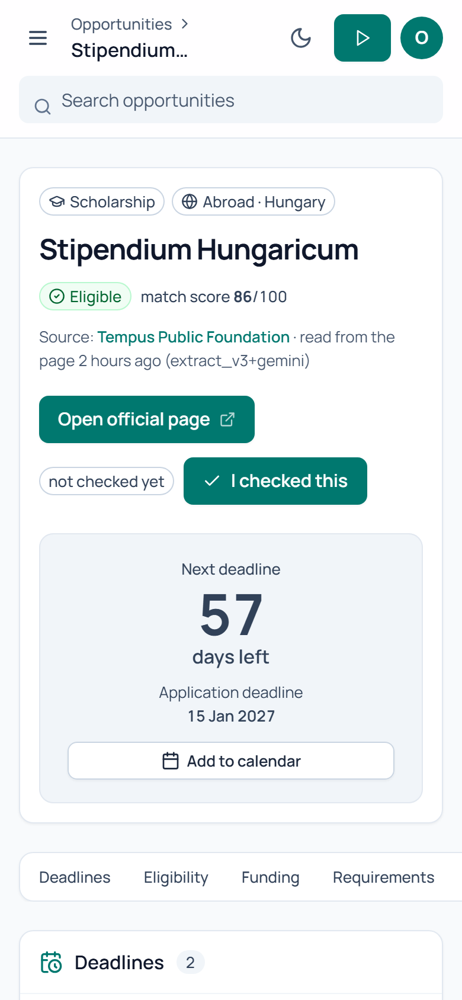

### Digest email

